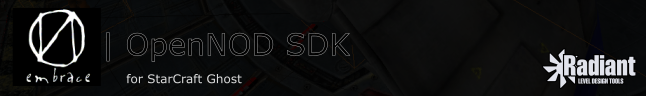

# OpenNOD Radiant



GtkRadiant fork for StarCraft: Ghost / NOD map restoration and authoring.
Supports brush MAP editing, live NOT entity placement and instance properties,
DDS/NSA material previews, NOD/NMB props, and SDK-backed level conversion.

## Requirements

- Git, Bash, Python 3.9+.
- **Windows:** Git Bash, Visual Studio 2022 C++ workload, Windows SDK.
  The editor builds as **Win32**; an external x64 SDK is supported.
- **Linux:** C/C++ compiler, pkg-config, SCons, and development packages for
  GTK2, GtkGLExt, libxml2, JPEG, PNG, zlib, and OpenGL.
- [OpenNOD SDK](https://github.com/aknavj/nodsdk-scghost) binaries:
  `NODTemplates`, `NOTEditor`, `NSDEditor` (`.exe` on Windows).
- Extracted game assets; the asset root must contain `Materials`.
  Original assets remain read-only and are not included.

## Build and run

From the repository root:

```sh
bash build.sh \
  --sdk-dir "/path/to/OpenNOD-SDK" \
  --asset-root "/path/to/game_files" \
  --workspace "/path/to/authoring"

cd install
./radiant.exe  # Windows; use ./radiant.bin on Linux
```

Windows paths such as `'C:\SDK\OpenNOD-SDK-0.6.7-windows-x64'` are accepted.

| Option | Environment variable | Default |
| --- | --- | --- |
| `--sdk-dir DIR` | `NOD_SDK_DIR` | Existing `install/scghost.game`, then a single sibling SDK package. |
| `--asset-root DIR` | `NOD_ASSET_ROOT` | Existing `install/scghost.game`. |
| `--workspace DIR` | `NOD_WORKSPACE` | Existing profile workspace, then `install/workspace`. |
| `--configuration Release\|Debug` | - | Release |
| `--jobs N` | - | CPU count |

The root [build_scghost.py](build_scghost.py) helper restores dependencies,
builds the editor and required modules into `install`, configures the SC Ghost
profile, and verifies NOT templates. BSPC and Quake map compilers are not built.

## Usage

- Open `<workspace>/nod/maps/test_room.map` or create a new MAP.
- **N > Entities > Place entity:** browse and place NOT templates.
- **File > Project Settings:** configure asset and SDK paths. Missing paths
  can leave the placement list empty; restart after changing the asset root.
- **Bsp > Convert NOD level...:** requires same-build SDK executables
  `MAPtoNIL`, `MAPtoNSD`, and `MAPtoNPD`.
- Radiant edits instance overrides; shared NOT edits belong in NOT Editor.

## Clean

From the repository root:

```sh
bash clean.sh
```

Close the editor first. Cleanup uses MSBuild/SCons to remove compiler outputs
for the selected configuration. Dependencies, profiles, preferences, maps, and
original assets are kept. Use `--configuration Debug` to clean a Debug build.
Do not build and clean concurrently.

## Status and documentation

Experimental; not the original editor or complete NOD engine support.
Windows build/startup and clean/rebuild are verified. Native Linux compilation
remains unverified. Keep map backups and validate exports in a disposable runtime.

- [StarCraft Ghost workflow](gamepacks/SCGhostPack/README.md)
- [Changelog](CHANGELOG.md)
- [Issues](https://github.com/aknavj/nodsdk-radiant/issues)
- Based on [GtkRadiant](https://github.com/TTimo/GtkRadiant); fork version
  **0.6.7**, aligned with OpenNOD SDK.

## Project scope and license

Tools for StarCraft: Ghost map restoration and preservation, not a game remake.
No proprietary game assets are included; their rights and licensing remain separate.

Based on GtkRadiant (**GPL-2.0-or-later**), with **GPL-3.0** fork contributions.
Some components use BSD or LGPL licenses. Preserve original copyright and license
notices. See [LICENSE](LICENSE), [GPL](GPL), [LGPL](LGPL), [BSD](BSD), and source headers.
GPL permits commercial use subject to its terms.

---
This project uses AI-assisted development with collaborative human/AI oversight
and human review of output.